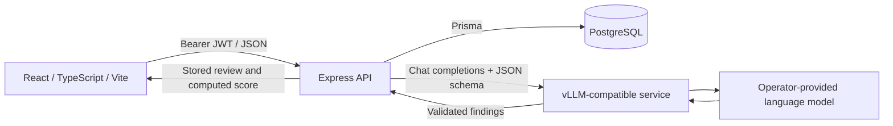

# CodeReviewer

Release candidate: the web application passes local checks, but the training dependency audit has unresolved advisories. See [verification and release blockers](docs/verification.md) before publishing or deploying.

CodeReviewer reviews pasted source code and Git diffs using a language model. A React interface submits authenticated requests to an Express API, which stores review history in PostgreSQL and calls an OpenAI-compatible inference server. Model responses are validated as structured findings; the backend computes a deterministic severity-based score.

The repository also contains the original Qwen2 QLoRA training implementation, reviewed for portability and privacy. **Datasets, adapters, checkpoints, model weights, and user records are not distributed.** A compatible running model service is required for actual AI reviews. No review-accuracy benchmark is claimed.

## Architecture



See [architecture and request diagrams](docs/architecture.md), [API contract](backend/API.md), [security boundaries](SECURITY.md), [training](docs/training.md), and [deployment](docs/deployment.md).

## Implemented functionality

- Account registration/login with bcrypt password hashing and expiring JWTs.
- Per-user projects, review creation/history/search/filtering, and deletion through the API.
- Pasted code, diff, and file-content review modes; submissions are treated as text and never executed.
- Validated findings with severity, category, source location, explanation, and suggested fix.
- Dashboard aggregates and real review findings; empty workspaces show no fabricated metrics.
- Inference timeouts, bounded concurrent requests, request limits, and persistent failed-review status.
- Local preprocessing, train/validation/test loading, assistant-only loss masking, Unsloth LoRA training, adapter merging, and interactive local inference.

The frontend uses React 19, TypeScript 6, Vite 8 and plain CSS. The backend uses Express 4, Prisma 6, PostgreSQL, Zod, JWT and bcrypt. Training uses PyTorch, Unsloth, Transformers, TRL and PEFT. Tailwind is not a dependency. Repository URLs are metadata: there is no GitHub webhook, repository cloning, or automatic PR commenting.

## Local installation

Requirements: Node.js 22.12+ (22.22.0 is the CI/Docker reference), npm, PostgreSQL 16+ or Docker Compose, and a compatible external model service. Python is optional for the web app; Python 3.11–3.12 is the training target.

From a fresh checkout:

```bash
cp .env.example .env
cp backend/.env.example backend/.env
cp frontend/.env.example frontend/.env
openssl rand -hex 32
```

Put the generated value into `JWT_SECRET` in `backend/.env`. The template intentionally leaves this required secret empty. Local database examples use `local-development-only`; replace it in both `.env` and the database URL when changing credentials. Production requires unique random credentials.

Start only the local database (skip if using an existing PostgreSQL server):

```bash
docker compose up -d postgres
```

Install and migrate:

```bash
cd backend
npm ci
npm run db:generate
npm run db:deploy
npm run build
npm start
```

In another terminal, from the repository root:

```bash
cd frontend
npm ci
npm run dev
```

Open the frontend URL printed by Vite (normally `http://localhost:5173`), create an account, and submit a small synthetic snippet. The first submission creates a default project if necessary; projects can also be managed through the API. Configure inference before expecting a completed review. If inference is offline, the submission is saved as `FAILED` with a safe explanation.

For production, serve `frontend/dist` using a static web server and deploy the API behind HTTPS. Vite's development and preview servers are for development. See [deployment](docs/deployment.md).

## Configuration

Backend variables are read from `backend/.env` when commands run from that directory. Never commit actual environment files. Every variable is listed in [configuration](docs/configuration.md). `DATABASE_URL` and a random `JWT_SECRET` are required. `MODEL_API_URL` identifies the chat-completion endpoint; `MODEL_NAME` must match the server's served model name. Optional `MODEL_API_KEY` is backend-only.

The only frontend variable is `VITE_API_URL`, embedded at build time. It is a public API base URL, **never a secret**. The root `POSTGRES_PASSWORD` is used by local Compose.

## Inference

The API sends a non-streaming `POST` to `/v1/chat/completions` using `response_format.type=json_schema`. A plain text completion endpoint is insufficient. See [inference setup](docs/inference.md) for merge and vLLM commands, model naming, context budgets and deployment assumptions.

The historical model was trained to emit a single free-text review comment, whereas the web API requests JSON findings. Constrained decoding enforces structure, not useful reviews. A trained model's compatibility and quality must be evaluated separately. No fine-tuned weights are publicly available in this release.

## Training

Inspect the verified settings without installing GPU dependencies or loading a model:

```bash
python -m src.training.train --config configs/train.json --validate-only
python -m src.training.preprocess --help
```

The actual default is a **1,024-token context**, rank/alpha 16, 4-bit loading, three epochs, learning rate `2e-4`, microbatch 1 and accumulation 16 on one device. Historical notes mentioning 2,048 tokens do not match the configuration. See [training documentation](docs/training.md) before acquiring data or installing CUDA dependencies.

## Tests and verification

No GPU, dataset, model weights or inference credentials are needed for these checks:

```bash
python -m unittest discover -s tests -v
python -m compileall -q src tests
python -m src.training.train --config configs/train.json --validate-only
python scripts/check_public.py
cd backend
npm ci
npm run db:generate
npm test
npm run lint
npm run build
cd ../frontend
npm ci
npm run lint
npm run typecheck
npm run build
```

Python formatting/lint commands after installing `requirements-dev.txt`:

```bash
ruff check src tests scripts
ruff format --check src tests scripts
```

Database integration tests require a **disposable, migrated** database. Set `DATABASE_URL` to it, then run from `backend`:

```bash
npm run db:deploy
RUN_DATABASE_TESTS=1 npm run test:integration
```

The integration suite runs a controlled HTTP model server and real PostgreSQL. It does not prove GPU training or live model quality. See [verification evidence](docs/verification.md). CI separates web checks, PostgreSQL integration, CPU Python checks, artifact checks and secret scanning.

## Limitations

- AI findings can be incorrect or incomplete; scores are heuristics, not security certifications.
- Review processing is synchronous. There is no durable job queue, streaming, automatic retry, or cancellation on browser disconnect. An admitted review continues for up to the configured timeout and is persisted; a process crash may leave `ANALYZING` rows.
- Review content is limited to 32,000 characters. The model context can be much smaller; the API does not tokenize or truncate requests. Context overflow becomes a failed review. Use small inputs and an appropriate output-token budget.
- Submitted code and findings are stored in PostgreSQL. Operate the database and model service under an explicit retention/privacy policy.
- The UI supports account access, review submission/history and dashboard views. Project CRUD is available through the API. File mode accepts pasted content, not multipart uploads. Source line numbers in diffs may not align with displayed input line numbers.
- No GitHub API integration, password reset, email verification, token revocation, or finding-resolution mutation endpoint is implemented.
- CUDA training/serving requires compatible hardware and a separately validated software stack. Full training, live vLLM inference and Docker image execution have not been established by CPU/mock tests.

## Source, models and licenses

Project source is released under [Apache-2.0](LICENSE). Third-party dependencies, models and datasets keep their own licenses; see [third-party notices](THIRD_PARTY_NOTICES.md). The [Qwen2-1.5B-Instruct model license](https://huggingface.co/Qwen/Qwen2-1.5B-Instruct/blob/main/LICENSE) is Apache-2.0. The [historical dataset card](https://huggingface.co/datasets/ronantakizawa/github-codereview) labels its license `other`; this source license grants no rights to dataset records or their underlying code. Users must establish their own data rights. No automatic dataset download occurs.
