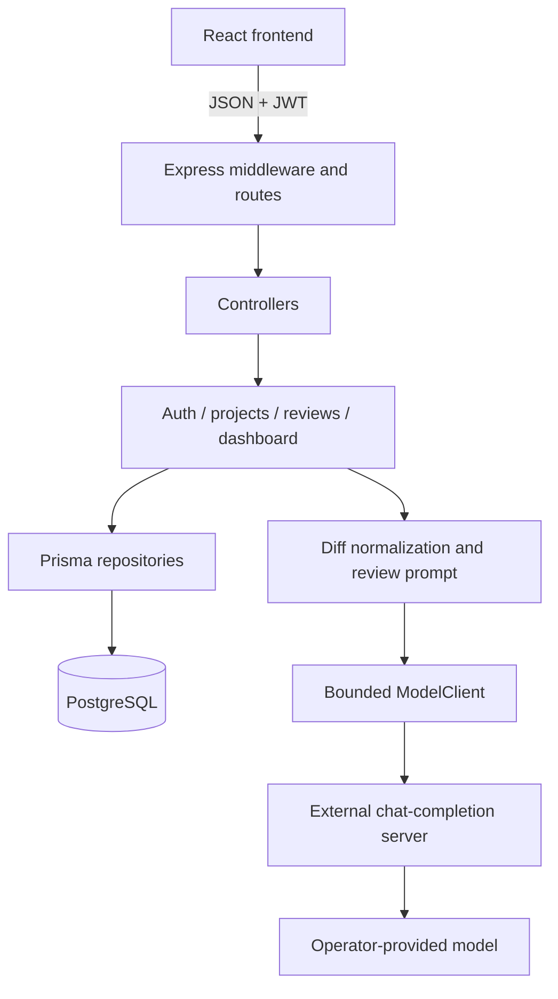
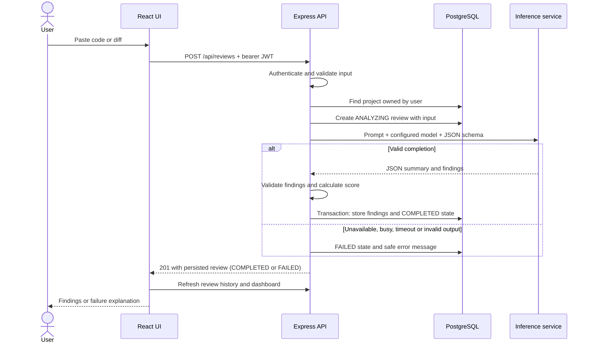
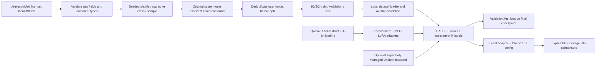
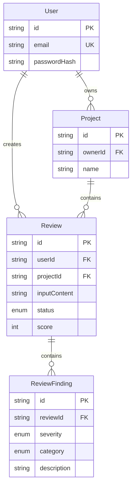

# Architecture

The existing monolith is retained: Express routes → controllers → services → Prisma repositories. Zod validates HTTP inputs. A JWT user identity scopes project/review operations and dashboard queries. The model output is parsed and validated separately from the request. React renders text via JSX; neither submitted code nor model output is executed or inserted as HTML.

## Application

## Code-review lifecycle

## Fine-tuning

## Inference and generation

```mermaid
flowchart LR
  Input[Untrusted code text] --> Normalize[DiffService normalization]
  Normalize --> Prompt[ReviewPromptService]
  Prompt --> Admission[Per-process concurrency admission]
  Admission --> Request[Chat-completion request with JSON schema]
  Request --> Server[vLLM + tokenizer chat template + model]
  Server --> Bound[Timeout and response-byte limit]
  Bound --> Parse[JSON extraction / parsing]
  Parse --> Zod[Finding and line-range validation]
  Zod --> Score[Backend severity scoring]
  Score --> Persist[Prisma review completion]
  Bound --> Failure[Safe error / failed review]
  Parse --> Failure
  Zod --> Failure
```

The HTTP schema constrains summary and findings. Optional fields not generated by the serving schema retain Zod/database defaults. The backend ignores model-supplied scores and calculates its own. The code prompt still uses the original user-message structure; prompt injection remains a model-quality boundary, mitigated by keeping output as untrusted text and avoiding tools/code execution.

## Database

Project/review deletes cascade to findings; deleting an account at the database level cascades its projects/reviews. No account-deletion HTTP route exists. Review completion stores findings transactionally. Dashboard raw SQL uses Prisma parameter bindings. The initial migration is retained and must be applied using `prisma migrate deploy`.
